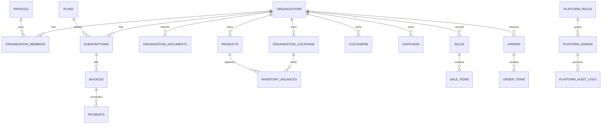

# DevEngine POS — Phase 1 Audit and Foundation

Status: UI foundation complete with dummy data; no production backend has been created or connected.

## Phase 1 UI delivery

- A public DevEngine POS marketing experience, plan comparison, multi-step business registration and pending-verification hand-off are present as prototype UI.
- Canonical prototype routes now separate public marketing, the DevEngine platform workspace, tenant storefronts, tenant sign-in and tenant administration.
- Tenant shell branding derives from the URL slug, while the platform Super Admin surface remains DevEngine-branded.
- All platform controls, plan, verification, billing and website-content interactions remain browser-only demo state. They are intentionally not authorization, provisioning, payment or legal-verification systems.

## Repository audit

| Area | Current state | Phase-1 finding |
| --- | --- | --- |
| Frontend | React 19, Vite 8, Tailwind v4 | Existing UI is concentrated in `src/App.tsx` and uses browser-local React state. |
| Public site | Branding, plans, public pages, registration UI | Presentation-only. Content changes are not persisted. |
| Tenant UI | POS, catalog, inventory, finance, employee, settings screens | Demonstration data only; no tenant-resolution or access enforcement. |
| Platform UI | `/platform` controls and verification queue | UI-only; no platform-auth guard, audit store, or real permission check. |
| Routing | Browser History API | Current URLs do not match the requested canonical SaaS route map. |
| Backend | None | No Worker, API, Supabase client, migrations, RLS, secrets, payment callback, or storage service exists. |
| Tests | Build only | No authorization, tenant-isolation, payment, or concurrency tests exist. |

### Conflict and safe migration

The current app renders both the tenant POS and the Super Admin controls from mock, frontend-only state. The requested platform requires server-enforced authorization, auditable writes, and database RLS. Reusing existing visual components is safe; treating their current buttons as real operations is not.

Migration rule: preserve the visual shell, replace browser-local mutations one module at a time with typed calls to `/api/v1`, and keep a feature behind a loading/error/empty state until its Worker service, database transaction/RPC, RLS policy, and tests exist.

## Canonical route map

| Area | Route | Access |
| --- | --- | --- |
| Marketing | `/`, `/product`, `/pricing`, `/about`, `/contact`, `/support`, `/privacy`, `/terms` | Public |
| Onboarding | `/signup`, `/signin` | Public; server rate limited |
| Platform | `/workspace`, `/workspace/dashboard`, `/workspace/organizations`, `/workspace/subscriptions`, `/workspace/plans`, `/workspace/users`, `/workspace/support`, `/workspace/settings` | Platform role only |
| Storefront | `/:tenantSlug`, `/:tenantSlug/products`, `/:tenantSlug/cart`, `/:tenantSlug/checkout`, `/:tenantSlug/account`, `/:tenantSlug/orders` | Public/customer scoped |
| Tenant admin | `/:tenantSlug/admin`, `/:tenantSlug/admin/products`, `/:tenantSlug/admin/inventory`, `/:tenantSlug/admin/orders`, `/:tenantSlug/admin/storefront`, `/:tenantSlug/admin/subscription`, `/:tenantSlug/admin/settings` | Verified tenant membership + permission |

`tenantSlug` is a public lookup key only. The API resolves it to an immutable organization UUID and never trusts a client-supplied organization identifier for authorization. Reserved slugs include `workspace`, `signup`, `signin`, `pricing`, `admin`, `api`, `support`, and every public platform route.

## Data model / ERD

### Required database rules

- UUID primary keys and `timestamptz`; money uses `numeric(18,2)` with a documented rounding policy.
- All tenant-owned tables include a non-null `organization_id`, foreign keys, indexes beginning with `organization_id`, and RLS enabled.
- Parent/child tenant consistency is enforced with composite foreign keys or server-side RPC checks—not only client filters.
- Sales, payments, transfers, returns, receiving, and online-order stock reservations use transactions plus idempotency keys.
- Stock and financial history are append-only; corrections use a traceable reversal or adjustment.
- Platform roles and tenant memberships are different tables and permission systems. No shared `isAdmin` flag.

## Role matrix

| Role | Boundary | Core authority |
| --- | --- | --- |
| Platform Owner | Platform | All platform configuration, role assignment, audit access |
| Super Admin | Platform | Organizations, verification, plans, billing, platform operations |
| Operations / Finance / Support / Content Admin | Platform | Only delegated platform modules |
| Tenant Owner | One organization | Business operations, team and subscription within its tenant |
| Tenant Manager / Cashier / Inventory / Delivery | One organization and optional location scope | Explicit role permissions only |
| Customer | One organization | Own profile, addresses, carts, orders, and support requests |

## Implementation plan and acceptance gate

1. **Foundation:** provision Supabase and Cloudflare Worker; add migrations, RLS matrix, seed tenants, and authorization tests.
2. **Platform access:** build server-provisioned platform admins, MFA, session controls, audit logging, and `/workspace` guard.
3. **Onboarding:** connect the six registration steps to a transaction-backed registration draft and verification workflow.
4. **Tenant resolution:** implement canonical routes and Worker tenant/membership/entitlement guards.
5. **POS and storefront modules:** migrate one UI module at a time to typed endpoints and transactions.
6. **Payments, notifications, security QA:** SSLCommerz sandbox callback verification, FCM, isolation/concurrency tests, monitoring, and deployment runbooks.

No phase is marked complete until its frontend, Worker authorization, migration/RLS, tests, loading/error handling, and audit behavior are complete.

## Required external decisions before Phase 2

- Supabase, Cloudflare, Firebase, Google OAuth, and SSLCommerz project ownership and sandbox credentials.
- Supported countries, currency/tax policy, organization-approval policy, retention policy, and legal-document policy.
- Exact first-release tenant modules and plan entitlements.
- Whether customer storefronts launch in the first production release or after core POS operations.
